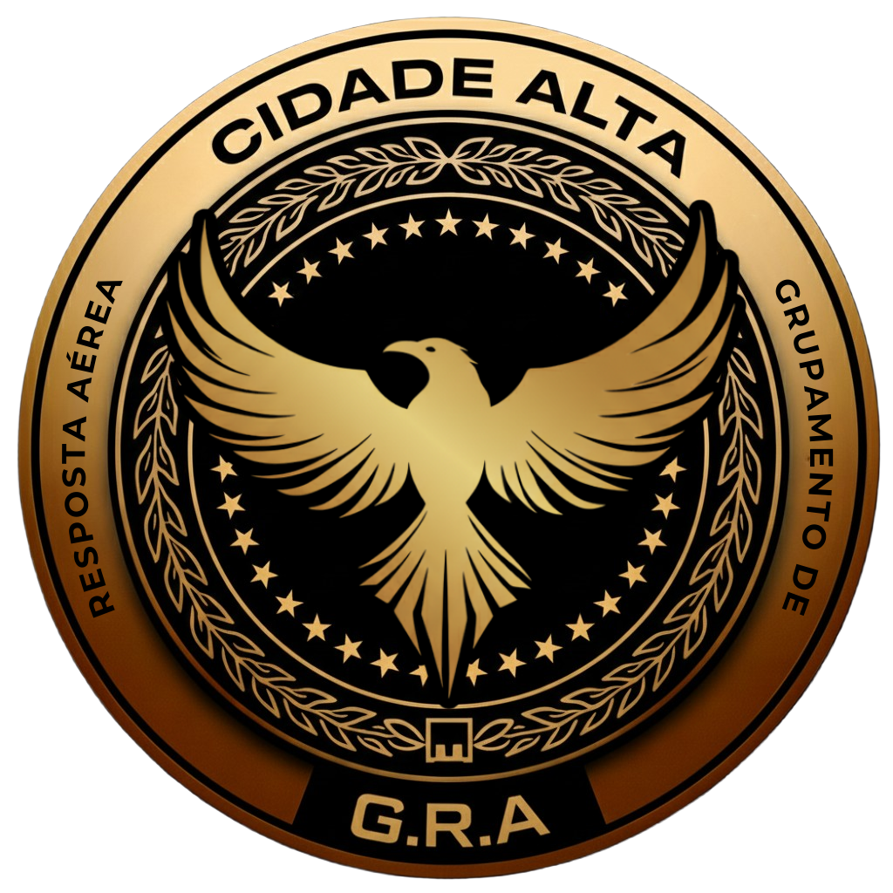
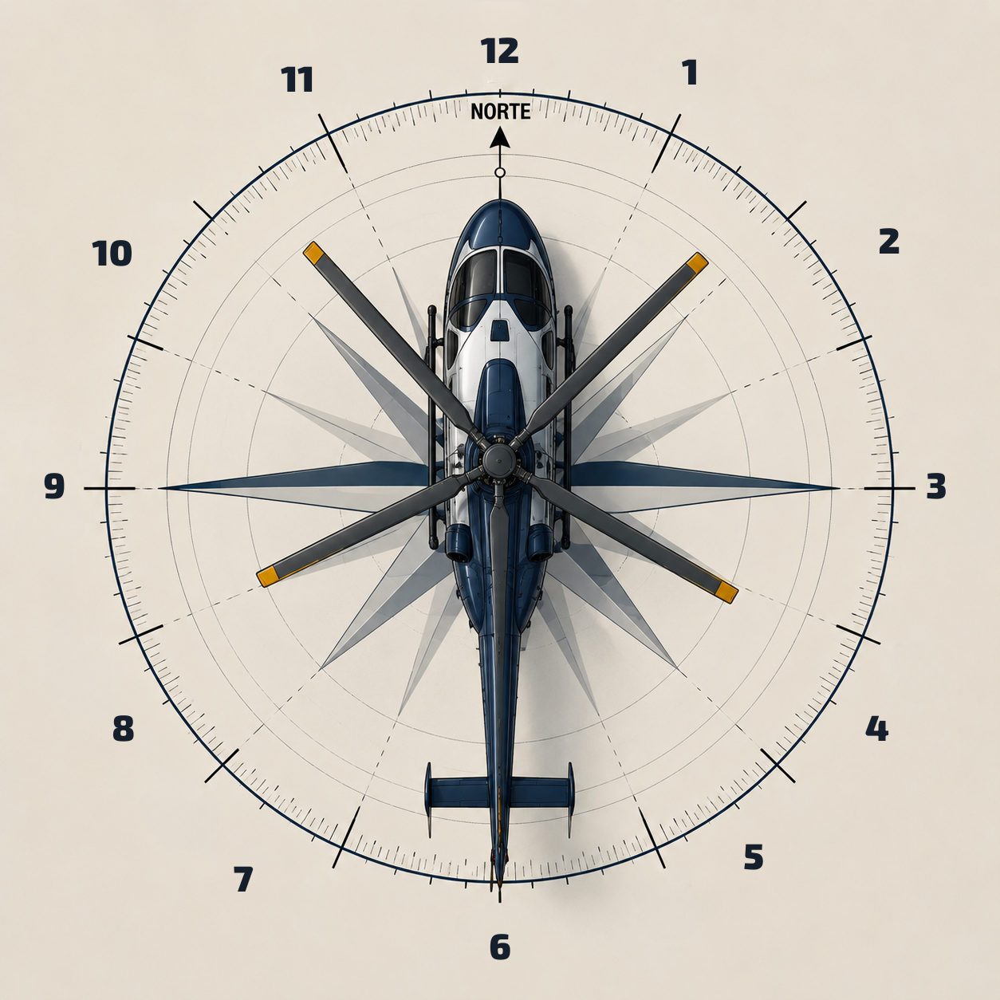

# ACOMPANHAMENTO E COMUNICAÇÃO

<figure><figcaption></figcaption></figure>

<h2 align="center">COMUNICAÇÃO EM HORAS</h2>

A **comunicação por horas** é um dos métodos mais utilizados na aviação para indicar a posição de objetos, ameaças, obstáculos e pontos de interesse em relação à aeronave.

Esse sistema oferece uma linguagem padronizada, rápida e precisa, permitindo que piloto, copiloto, operadores aerotáticos e equipes em solo compartilhem informações sem ambiguidades.

Ao utilizar a aeronave como ponto central de referência, todos os integrantes da operação passam a interpretar imediatamente a direção informada, reduzindo o tempo de resposta e **aumentando significativamente a consciência situacional da tripulação.**

Esse método é empregado em operações de patrulhamento, perseguições, buscas, resgates, missões policiais, apoio tático e qualquer situação em que a velocidade da comunicação seja determinante para o sucesso da missão.

***

<h2 align="center">Objetivos de Aprendizagem</h2>

Ao concluir este capítulo, o aluno será capaz de:

* **Compreender o conceito da comunicação por horas;**
* **Identificar corretamente todas as posições em relação à aeronave;**
* **Transmitir informações de forma objetiva e padronizada;**
* **Interpretar comunicações realizadas pela tripulação;**
* **Aplicar o sistema durante operações aéreas reais ou simuladas.**

A comunicação por horas consiste em imaginar um relógio de doze horas sobre a aeronave, considerando sempre o nariz da aeronave como a posição de **12 horas.**

Cada direção recebe uma referência numérica semelhante ao mostrador de um relógio.

***

<h2 align="center">Referências principais</h2>

|  HORÁRIO |         REFERÊNCIA         |
| :------: | :------------------------: |
| 12 HORAS | FRENTE (Nariz Da Aeronave) |
|  3 HORAS |        Lado direito        |
|  6 HORAS |            Cauda           |
|  9 HORAS |        Lado Esquerdo       |


**A figura apresentada neste capítulo representa essa distribuição espacial e deve ser utilizada como referência durante toda a formação.**


As posições intermediárias indicam direções mais específicas:

* **1 e 2 horas:** <mark style="color:$primary;">Frente direita</mark>
* **4 e 5 horas:** <mark style="color:$primary;">Traseira direita</mark>
* **7 e 8 horas:** <mark style="color:$primary;">Traseira esquerda</mark>
* **10 e 11 horas:** <mark style="color:$primary;">Frente esquerda</mark>

***

<h2 align="center">Princípios da Comunicação</h2>

Toda comunicação deve obedecer aos princípios fundamentais da comunicação aeronáutica

* Clareza
* Objetividade
* Rapidez
* Padronização
* Precisão

<mark style="color:$warning;">informações longas ou vagas comprometem a segurança operacional.</mark>

***

<h2 align="center">Estrutura da Comunicação </h2>

A transmissão deve seguir sempre a mesma sequência:

<mark style="color:$info;">**“ SEGUE SENTIDO OESTE NA VESPUCCI BOULEVARD PROXIMO AO VERMELHO “**</mark>

[**Acesse os guias das ruas para aprender.mais sobre**](https://docs.google.com/document/d/1YFj-V2lOEdOGGQEvgrGDKna8_1dJD9ni/edit)

***

<h2 align="center">Comunicação Rosa Dos Ventos</h2>

.jpeg>)

Na rosa dos ventos, eles compreendem um círculo e a distância entre os pontos cardeais são ângulos de 90º. O norte, como sendo a referência, corresponde a 0º; o leste, a 90º; o sul, a 180º; o oeste, a 270º.

***

<h2 align="center">Erros mais comuns</h2>

<mark style="color:$danger;">**Evite utilizar expressões subjetivas como:**</mark>

* Ali
* Na frente
* Mais para a direita
* Mais para a esquerda
* Atrás daquele prédio
* Depois daquela árvore
* Um pouco para cima


**Esses termos podem gerar interpretações diferentes entre os tripulantes e comprometer a coordenação da missão.**


***

<h2 align="center">Limite de Altitude</h2>

**Respeitar a altitude&#x20;**<mark style="color:red;">**máxima de 130 metros**</mark>**. O descumprimento durante o acompanhamento poderá resultar em&#x20;**<mark style="color:$warning;">**desligamento da GRA e punições administrativas na cidade**</mark>**, conforme as regras vigentes.**
