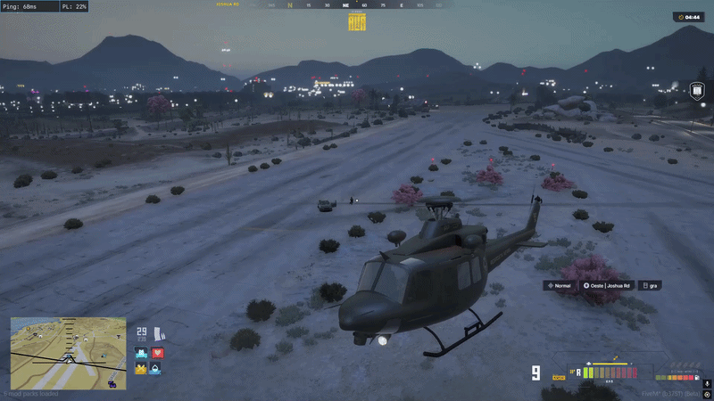

# ATIRADOR OPERACIONAL

## Introdução

Diante da necessidade de ampliar a integração entre o efetivo **RPM** e a **GRA**, institui-se o **Curso de Atirador Aéreo**, destinado a capacitar os policiais previamente autorizados a embarcar na aeronave para exercer a função de atirador em situações de <mark style="color:$warning;">**QRU de Código 5**</mark>. A participação no curso <mark style="color:$danger;">não representa autorização automática para embarque em qualquer ocorrência</mark>. O emprego do policial na função dependerá da aprovação na instrução, da autorização do comando e da disponibilidade operacional da aeronave e de sua tripulação.

***

## Funções Dentro Da Aeronave

<mark style="color:blue;"><strong>Piloto</strong></mark>

Comandante da aeronave, <mark style="color:$warning;">sempre respeite e obedeça as ordens do mesmo</mark>, ele está com total controle da aeronave, e sabe os próximos passos, ele fica responsável em manter o visual e segurança da tripulação.

<mark style="color:blue;"><strong>CO-Piloto</strong></mark>

Também conhecido como P2, responsável por manter o visual da ocorrência, e do que está acontecendo ao redor, responsável por auxiliar o piloto, com visual e posições.

<mark style="color:blue;"><strong>P3 e P4</strong></mark>

Os mesmo estão responsáveis em manter o visual da ocorrência, auxiliar o piloto e co-piloto, e devem estar prontos, caso precise realizar um reposicionamento, ou substituir um atirador abatido.

<mark style="color:blue;"><strong>Atiradores</strong></mark>

Responsáveis por realizar disparos quando necessários, e <mark style="color:$danger;">autorizados pelo comandante</mark> da aeronave, o atirador primário localizado a direita da aeronave tem melhor visual, e o secundário tem as mesmas funções.

***

## Técnicas De Disparos

1. \- Sempre tenha total certeza e precisão antes de realizar um disparo, em caso de erros ao disparar, pode ocasionar em problemas sérios caso acerte um cidadão.
2. \- Sempre que for disparar, avise o piloto, assim ele deixa o atirador com visual total.
3. \- O melhor atirador e com mais precisão, fica na direita, pois tem uma visão melhor.
4. \- Quando o piloto fizer uma manobra de aproximação fique pronto para realizar os disparos rapidamente e não ser baleado.
5. \- Como todos os oficiais sabem, armas de fogos matam, e por isso um atirador terá sempre que ter uma boa visão e uma boa precisão. Os armamentos de alto calibre, tem potência para disparar de longe e de perto.
6. \- <mark style="color:$danger;">O atirador não entra em confronto direto, ele atua em momentos oportunos ou como elemento surpresa.</mark>
7. \- Código 5 em pneus deve ser feito cadenciadamente, para não ter perigo de acertar o indivíduo.

Codigo 5 No <mark style="color:$warning;">PNEU</mark>

Fica autorizado a <mark style="color:$warning;">LIBERAÇÃO DE DISPARO NO PNEU</mark> de veículos que estejam se <mark style="color:$danger;">evadindo ou que seja confirmada a participação em disparos de arma de fogo</mark>, mesmo que não tenha atentado contra a vida de terceiros .

<figure><figcaption></figcaption></figure>

Codigo 5 No <mark style="color:$warning;">INDIVÍDUO</mark>

A liberação do código 5 no indivíduo só é permetido nas situações presentes abaixo:

1. Roubar uma viatura.
2. Atenta contra vida de algum civil ou policial.
3. É avistado com armamento em mãos durante uma <mark style="color:$danger;">QRU de CÓD. 5.</mark>
4. Propositalmente pula na água com o veículo durante a fuga.
5.
6. Inicia fuga de abordagem após a confirmação do mesmo estar se evadindo de um <mark style="color:$danger;">COD. 5</mark> <mark style="color:$warning;">**(Nesse caso, será liberado o disparo no pneu para imobilização do veiculo).**</mark>

<figure><figcaption></figcaption></figure>

