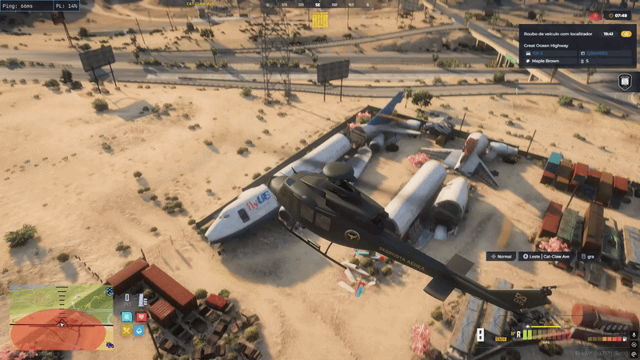

# Combate Aéreo

<h2 align="center">Introdução</h2>

O presente Curso de Heli Combate, com utilização da aeronave **B412**, tem como finalidade aprimorar as habilidades dos integrantes do <mark style="color:$warning;">GRA em ocorrências de maior complexidade</mark>, especialmente em situações de <mark style="color:$danger;">Código 5</mark>, nas quais a comunicação, a consciência situacional e a integração entre a equipe aérea e as unidades terrestres são fundamentais.

***

<h2 align="center">Resumo Do Conteúdo Programático</h2>

O curso será estruturado em módulos teóricos e práticos, contemplando os seguintes tópicos:

<mark style="color:blue;"><strong>Pilotagem e manobras</strong></mark>

instruções de pilotagem de ré e abertura de ângulo, com foco no domínio da aeronave e na execução coordenada das manobras.

<mark style="color:blue;"><strong>Posicionamento operacional</strong></mark>

orientações sobre posicionamento, comunicação e coordenação da equipe durante ocorrências de Código 5.

<mark style="color:blue;"><strong>Procedimentos de drop</strong></mark>

instruções referentes aos procedimentos de desembarque e inserção da equipe, considerando os diferentes cenários operacionais.

<mark style="color:blue;"><strong>Codigo 6</strong></mark>

estudo dos procedimentos aplicáveis às zonas vermelhas e zonas frias, com ênfase na identificação de riscos, na segurança e na coordenação entre os envolvidos.

<mark style="color:blue;"><strong>Pipa Combate</strong></mark>

instruções sobre os procedimentos e a dinâmica da modalidade, incluindo comunicação, coordenação e atuação integrada da equipe aérea.

<mark style="color:blue;"><strong>Comunicação e padronização</strong></mark>

treinamento de comunicação entre piloto, tripulação e equipes em solo, visando reduzir falhas de coordenação durante as ocorrências.

<mark style="color:blue;"><strong>Simulações operacionais</strong></mark>

exercícios controlados para avaliação do desempenho individual e coletivo, identificação de falhas e aperfeiçoamento dos procedimentos


A finalidade do curso é contribuir para a evolução técnica dos integrantes da unidade, promover maior padronização operacional e preparar as equipes para lidar com ocorrências de código.5.


***

<h2 align="center">Procedimento de Voo</h2>

<strong>Manobras De Voo</strong>

Refere-se a habilidade da aeronave de permanecer estacionária no ar, sem avançar em uma direção específica. Isso é alcançado ajustando cuidadosamente a potência dos motores e o ângulo das pás do rotor principal.

**VOO LATERAL**: Refere-se a capacidade da aeronave de se deslocar lateralmente, para os lados, sem necessariamente alterar sua orientação longitudinal. Esse movimento é possível ao inclinar o helicóptero para o lado desejado, direcionando o empuxo do rotor principal para o lado desejado.

**VOO VERTICAL:** Refere-se a capacidade da aeronave de subir ou descer verticalmente, sem avançar para frente ou para trás. Essa manobra é possível controlando a potência do motor e o passo das pás do rotor principal.

***

<strong>MANOBRAS EVASIVAS</strong>

<mark style="color:blue;"><strong>GIRO REPENTINO</strong></mark>

O helicóptero realiza o giro em seu próprio eixo vertical, para evitar que o piloto e demais tripulantes sejam atingidos.

<mark style="color:blue;"><strong>DESCIDA RÁPIDA</strong></mark>

Manobra realizada para perder altitude em alta velocidade.

<mark style="color:blue;"><strong>MANOBRA DE RECUO</strong></mark>

Voo de ré, para evitar que o piloto seja atingido, e possa realizar uma manobra de aproximação em situações de código 5.

<figure><figcaption></figcaption></figure>

<mark style="color:blue;"><strong>VOO A BAIXA ALTITUDE</strong></mark>

Manobras realizadas próximo ao solo para chamar atenção, desviar de obstáculos, e obter visual mais precisamente.

<figure><figcaption></figcaption></figure>

<mark style="color:blue;"><strong>VOO LATERAL</strong></mark>

Manobra para garantir um bom visual para o atirador.

***

<strong>PROTOCOLOS DE POUSOS</strong>

Os protocolos de pouso servem para garantir a segurança de toda a tripulação e demais oficiais em um dos momentos mais críticos do voo. Sendo eles:

1. Verificar as condições da área de pouso.
2. Posicionar-se acima da zona de pouso, com ajuda da comunicação dos demais tripulantes.
3. Perder altitude lentamente.
4. Pousar com calma e delicadeza, com comunicação com os demais tripulantes.
5. Desligar os motores.
6. Autorizar o desembarque.
7. Trancar a aeronave.

***

<mark style="color:$danger;"><strong>POUSO DE EMERGÊNCIA</strong></mark>

O pouso de emergência acontece quando a aeronave está comprometida, com isso o piloto deve prezar pela segurança da tripulação, sendo assim ele deverá perder altitude o mais rápido possível, inclinando o bico da aeronave para baixo, e então próximo ao solo deve levantar o bico da aeronave diminuindo o impacto da aeronave com o solo.

<figure><figcaption></figcaption></figure>

***

<strong>MOVIMENTAÇÃO</strong>

<mark style="color:blue;"><strong>EIXO LONGITUDINAL</strong></mark>

Eixo imaginário da proa até a cauda, por meio do qual a aeronave faz o movimento de rolamento, para a esquerda e direita, executado pelo comando cíclico, executado pelo comando cíclico, é responsável pela estabilidade lateral.

<mark style="color:blue;"><strong>EIXO LATERAL OU TRANSVERSAL</strong></mark>

Eixo imaginário que atravessa a aeronave da esquerda para direita, próximo ao monstro e ao centro da fuselagem, pelo qual a aeronave faz o movimento de arfagem ou tangagem. Esse movimento faz a aeronave picar, ou seja, descer o nariz empurrando-se o cíclico, ou levantar a proa, quebrando-a quando puxa o comando cíclico para trás, é responsável pela estabilidade longitudinal.

<mark style="color:blue;"><strong>EIXO VERTICAL</strong></mark>

Eixo imaginário que atravessa a aeronave de cima para baixo, próximo ao monstro, pelo qual a aeronave faz o movimento e giro ou guinada por meio dos pedais (comando do rotor de cauda), é responsável pela estabilidade direcional.

***

<strong>PILOTAGEM EM OCORRÊNCIAS</strong>

Em ocorrências o piloto deve sempre manter a segurança da aeronave, dos tripulantes e demais oficiais e civis em acompanhamento, sendo assim, procurar não explodir a aeronave, e manter a mesma de forma correta para que em casos de código 5, não ser alvejado e até mesmo baleado.

1. Nunca se mantenha atras do acompanhado, para não ser o primeiro baleado da aeronave.
2. Mantenha sempre na lateral do acompanhado, assim dando visual  para os atiradores.
3. Esteja pronto para curvas bruscas e manobras evasivas.
4. Fique atento na rádio, para saber de todas as informações.

***

<h2 align="center">I<strong>nformações Gerais</strong></h2>

1. Em situações de <mark style="color:$danger;">**cod. 5**</mark> na ausência de Comando ou **GOT** a **GRA** deve orientar o resto das unidades limpando o perímetro e controlando a situação.
2. Em <mark style="color:$danger;">QRU de cod. 5</mark> ou ações fechadas lembre-se de manter a distância adequada que a aeronave não seja alvejada.
3. Para fazer uma aproximação de interceptação faça a manobra de aproximação com a cauda do helicóptero diminuindo as chances de ser acertado.

***

<h2 align="center">Combate Aéreo</h2>

<mark style="color:blue;">LIBERAÇÃO DE CÓDIGO 5</mark>

Caso uma aeronave efetue <mark style="color:$danger;">disparos</mark> contra oficiais, civis ou contra a aeronave policial, será autorizada a aplicação do Código 5 aos tripulantes envolvidos, incluindo o piloto.

<mark style="color:blue;">SEGURANÇA DE VOO</mark>

Durante qualquer confronto aéreo, o piloto deverá priorizar a integridade da tripulação, o controle da aeronave e a prevenção de colisões.

<mark style="color:blue;">CONSCIENCIA SITUACIONAL</mark>

A tripulação deverá manter atenção constante às condições do espaço aéreo, à presença de outras aeronaves e aos possíveis riscos para os oficiais e civis envolvidos na ocorrência.

<mark style="color:blue;">COMUNICAÇÃO</mark>

O piloto e os demais integrantes deverão manter comunicação clara, objetiva e contínua sobre quando dar ângulo e efetuar o disparo.

<mark style="color:blue;">COORDENAÇÃO COM UNIDADES EM SOLO</mark>

Sempre que necessário, a equipe aérea deverá informar às unidades terrestres as condições da ocorrência para apoio em solo.

<mark style="color:blue;">ALTITUDE E DISTÂNCIA</mark>

A tripulação deverá respeitar as separações necessárias entre aeronaves, deve sempre se permanecer acima da aeronave inimiga para vantagem visual e de ângulo para os disparos.

<mark style="color:blue;">MANOBRA DE RECUO</mark>

A aeronave <mark style="color:$danger;">DEVE</mark> se manter de ré, para evitar que o piloto seja atingido, e possa realizar uma manobra de aproximação em situações de código 5, areas de zona de perigo e zona fria para o atirador realizar disparos.

<figure><figcaption></figcaption></figure>

<mark style="color:blue;">ATUAÇÃO DO PILOTO</mark>

O piloto permanece responsável pelo controle e pela segurança da aeronave, devendo avaliar continuamente as condições de voo e a viabilidade de prosseguir na ocorrência.

***

<h2 align="center">Zona De Perigo e Zona Fria</h2>

<mark style="color:$danger;">ZONA DE PERIGO</mark>

Considera-se zona de perigo a área em que há ameaça ativa ou potencial contra as equipes envolvidas, especialmente durante ocorrências de Código 5

ZONA FRIA

Considera-se zona fria a área em que não há ameaça imatedia identificada, mas que exige atenção e avaliação contínua durante a operação.

***

<h2 align="center">Movimentação Da Aeronave</h2>

Durante operações em Zona de Perigo e Zona Fria, o piloto deverá <mark style="color:$warning;">priorizar o Código 6 com a aeronave em movimento, evitando permanecer parado ou pairando por tempo prolongado.</mark>

A movimentação constante tem como finalidade reduzir a exposição da tripulação e evitar que a aeronave permaneça em uma posição previsível durante a ocorrência.

O piloto deverá manter a comunicação com o atirador e realizar os ajustes necessários de posicionamento, garantindo que ambos permaneçam coordenados durante toda a operação.


**O HELICÓPTERO NÃO DEVE PERMANECER PARADO DESNECESSARIAMENTE EM ZONAS DE RISCO. A SEGURANÇA DO PILOTO E DOS ATIRADORES DEVE SER PRIORIDADE.**


<mark style="color:$success;"><strong>Jeito Correto</strong></mark>

<figure><figcaption></figcaption></figure>

<mark style="color:$danger;"><strong>Jeito Incorreto</strong></mark>

<figure><figcaption></figcaption></figure>


**O Helicóptero pode ser blindado porem não podemos confiar 100% nele, pois a blindagem em algum momento ela pode vim a falhar.**


***

<h2 align="center">Manobra De Recuo e Posicionamento</h2>

Durante o Código 6, o piloto deverá **priorizar a manobra de recuo, mantendo a cauda do helicóptero voltada para a área de interesse**, conforme as regras operacionais do servidor. Essa conduta tem como objetivo favorecer a proteção do piloto e dos atiradores, mantendo a aeronave em movimento durante a ocorrência.

Caso o piloto não domine a manobra de recuo, poderá utilizar o posicionamento com o bico da aeronave, desde que mantenha o controle do helicóptero e continue realizando a movimentação necessária.
